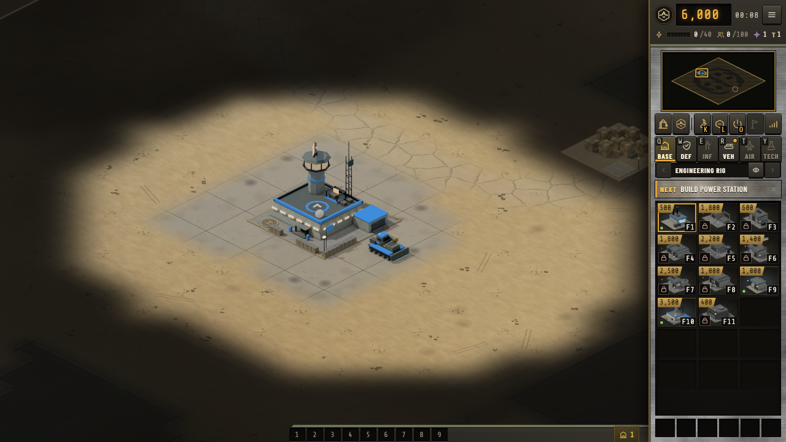
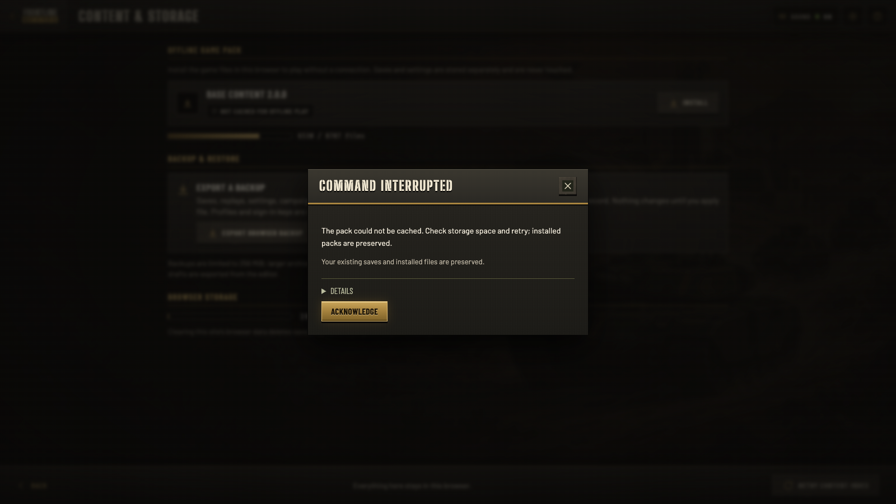

# App and game demo browser QA — 16 November 2026

The frozen Apple Silicon demo passed the app navigation, paid skirmish,
save/load, two-player lifecycle, four-player deployment/commands and both co-op
start checks below. No page crashes or page exceptions were observed in those
runs. Offline reload and saved-game restore also passed in a normal persistent
Chrome profile. This is a scoped test record,
not a guarantee against a demo crash or a full release certification.

This PR records QA only. It changes no application code, game data, launchers,
presentation slides or dependencies.

## Exact artifact and environment

- Package: `dist/frontline-darwin-arm64`, built `2026-11-16T02:29:12.731Z`.
- Simulation `0.3.8`, protocol `1`; source revision
  `c950d1c0c6a6a06310dc6109c0d9395737b5767f`, **source_dirty: true**.
  These results apply to the hashed package, not an assertion that the PR base
  or a clean checkout of that revision produces identical bytes.
- Main bundle: `index-B8JSb3qM.js`; hashes are in the adjacent
  [evidence receipt](evidence/demo-browser-qa-2026-11-16/receipt.json).
- macOS, Apple M4, 16 GiB RAM. Google Chrome `157.0.8103.52` and
  Chromium `151.0.7922.34`, automated with installed Playwright.
- Browser plugin not available; regular Playwright used. Chrome runs were
  headless with Metal GPU flags; the measured renderer was ANGLE Metal / Apple M4.
- Desktop viewports included 1600×900 and 1280×720, DPR 1.
- Isolated host `http://127.0.0.1:8128`, fresh test data and owned browser profiles.
  Normal demo data and the user's browser profiles were not used.
- Five subagents split navigation, network interactions, browser/offline checks,
  package review and endurance preparation. Rendered browser lanes ran serially.

## Results

| App or game flow | Observed result |
| --- | --- |
| First run and app navigation | Home rendered; Campaign, Field training, Practice range, Command record and Help opened and returned home. These were navigation checks, not full mission completions. |
| Paid skirmish | US vs Easy reached the rendered battlefield. Power station cost reduced credits 6000→5500; a paid Engineering rig queued and completed. |
| Battlefield controls | Selection, accepted Move order, visible rig movement, camera and zoom worked. |
| Save and restore | Pause/save, page reload and actual saved-game load restored the paid 4700-credit balance; portable save export succeeded. |
| Repeated entry | Saved game→Home→stable Skirmish row→new Industrial Valley match began with 6000 credits and returned home. |
| 720p layout | Actual battlefield and command sidebar fit 1280×720; canvas and sidebar were measured separately. |
| Offline play in a normal profile | Full pack activated; disconnected reload restored the paid 4700-credit save and the game clock advanced. A fresh offline practice game also started and advanced. WASM was served by the service worker with the expected hash. |
| Two-player lifecycle | Invite join, ready/deploy, accepted commands from both, shared pause/resume, guest reload/rejoin, another accepted command, results and both joining rematch passed. Surrender produced the results. |
| Four-player 2v2 | Four isolated commanders joined/deployed; every commander received an accepted Stop execution receipt. All four received the recorded team outcome. |
| Eliminated-player recovery | The asynchronous “View result and replay” action opened Network operation controls with recorded result, rematch and replay actions. |
| Convoy Union and Twin Outposts | Both co-op scenarios launched with two commanders; each issued an accepted Stop command. Natural mission victories were not tested. |
| Package integrity | All package-manifest hashes verified; test host matched the package. ZIP checksum, all 8964 payload names/sizes and 14 streamed critical payload hashes matched the frozen dist. No fresh full ZIP extraction was performed in this run. |

The Chrome solo/offline scripts collected page, console, HTTP and request errors;
their online gameplay checks recorded none. The network scripts recorded no page
exceptions, HTTP failures or page crashes, but did **not** separately collect
console messages. Do not generalize that result to “zero console errors” for the
entire network suite.

## Offline finding and test-driver corrections

In a fresh incognito Chrome context, Content & Storage→Install failed around
6530/8787 files with **Command interrupted — The pack could not be cached**.
The app stayed responsive and did not crash. The reported storage quota alone
did not explain the failure. This run did not capture a definitive underlying
browser exception, so a quota cause remains an inference.

A separate owned persistent Chrome profile reached 8787/8787 files and about
1.468 GB CacheStorage usage. A bounded follow-up confirmed 8789 cache keys:
8787 files, one manifest and one ready marker, with matching pack identity.
After the asynchronous installed-pack list resolved, the UI offered Reinstall.
Disconnected reload, exact save restoration, resumed game ticks and a fresh
offline practice game then passed. Offline network attempts produced expected
`ERR_INTERNET_DISCONNECTED` messages before service-worker fallback; these are
recorded separately from the error-free online checks. Persistent storage was
not granted (`navigator.storage.persisted()` was false), so this does not prove
that the browser will retain the pack indefinitely.

Two other apparent failures were corrected automation assumptions:

- After saves load asynchronously, the home hero changes from Set up skirmish to
  Continue. The initial driver resumed the saved operation. The stable Skirmish
  row passed the targeted fresh-match retest.
- An eliminated 2v2 commander stays frozen until the team result arrives.
  Its result action opens Network operation controls, not an automatic
  Victory/Defeat dialog. The targeted action passed; the four-client rematch
  sequence remains unverified.

Original failed attempts were retained locally; they are not counted as passing
product tests. No app fixes were made to obtain these passes.

## Demo use and remaining coverage

Use the packaged local host in a normal Chrome profile. Load the intended
skirmish before presenting, pause once the battlefield is ready, and save that
point. Keep the host terminal open. For starting a fresh match after saving,
use the stable Skirmish menu row. Confirm the offline-ready state and a real
offline reload separately before depending on browser offline play.

At the user's wrap-up request, the prepared 15-minute live soak, separate
two-minute synthetic 688-actor probe, default-GPU headful Chrome check, Firefox
and WebKit runs were not launched. They are **unrun**, not passes. Other gaps:
four-client rematch, natural co-op victory, long late-game AI behavior, physical
LAN, four real people, mobile and other operating systems. Prior historical
test receipts were not counted as newly executed coverage.

The committed receipt is a sanitized summary. Screenshots below show a rendered
720p battlefield and the recoverable incognito storage error. Raw logs, temporary
drivers and profiles remain in the local QA directory; they are not included in
this PR. No saves, player credentials, moderator tokens or invite links are
published.

